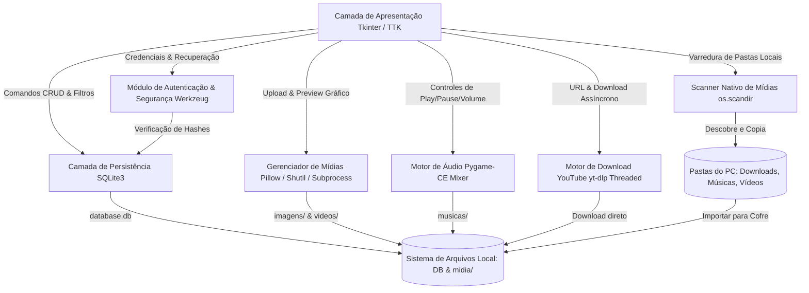
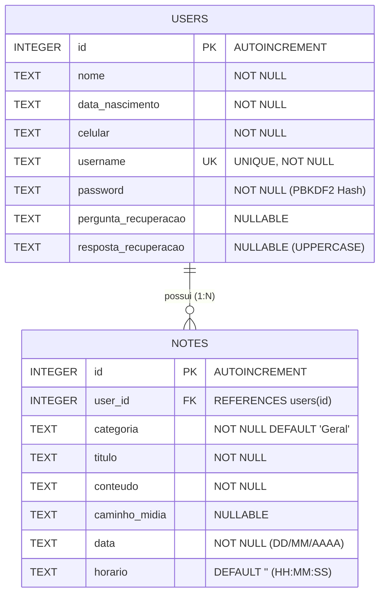
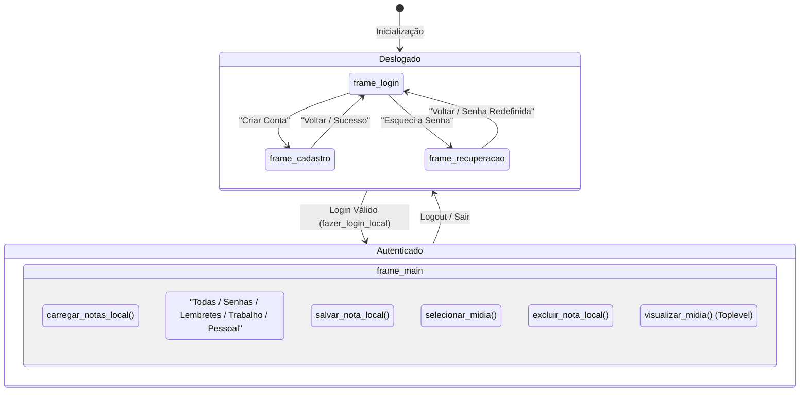

# 📋 Documento de Especificação Técnica (Spec-Driven Development - SDD)
## Projeto: Cofre de Notas & Senhas Offline

---

### Metadados do Documento
| Campo | Detalhe |
| :--- | :--- |
| **Identificador da Especificação** | `SDD-NOTAS-PJ-001` |
| **Versão da Especificação** | `1.0.0` |
| **Status** | `Aprovado / Implementação Referência` |
| **Data de Emissão** | 2026-10-27 |
| **Autor Técnico** | Equipe de Engenharia / Antigravity Agent |
| **Sistema Alvo** | Aplicação Desktop (`Windows / Linux / macOS`) |
| **Linguagem / Framework** | Python 3.10+ / Tkinter & TTK |

---

## 1. Visão Geral e Princípios Arquiteturais

### 1.1 Declaração de Propósito
O **Cofre de Notas & Senhas Offline** é um sistema de software desktop projetado para a custódia, organização e recuperação de notas textuais, credenciais confidenciais, lembretes operacionais e anexos de multimídia (imagens e vídeos). O software prioriza a soberania do usuário sobre seus dados, operando sob uma filosofia estrita de **Zero Cloud Dependency** (100% offline).

### 1.2 Princípios de Design (Core Tenets)
1. **Isolamento e Privacidade Absoluta**: Nenhum dado ou telemetria trafega fora do ambiente operacional local do usuário.
2. **Persistência Confiável**: Operações no banco de dados SQLite local devem seguir o padrão ACID (Atomicidade, Consistência, Isolamento, Durabilidade).
3. **Criptografia e Hashing Robusto**: Credenciais jamais são gravadas em texto plano, utilizando funções criptográficas de derivação de chave padronizadas.
4. **Portabilidade de Binário**: Capacidade de geração de executável standalone via PyInstaller sem necessidade de instalação prévia de interpretadores ou bibliotecas externas pelo usuário final.
5. **Ergonomia Visual Adaptativa**: Suporte nativo a temas Claro (*Light*) e Escuro (*Dark*), garantindo legibilidade e contraste adequado.

---

## 2. Personas e Casos de Uso (User Stories)

### 2.1 Personas
* **Usuário Pessoal / Doméstico**: Necessita de um local centralizado para guardar anotações rotineiras, comprovantes e fotos de documentos com privacidade.
* **Profissional Autônomo / PJ**: Demanda organização de credenciais de acesso de clientes, lembretes com carimbo de data/hora pontual e manuais em formato de vídeo ou imagem.

### 2.2 Histórias de Usuário & Critérios de Aceite (Gherkin Format)

#### US-01: Cadastro de Usuário Seguro
* **Como** um novo usuário do sistema,
* **Quero** cadastrar meu perfil com nome, data de nascimento, celular, credenciais e pergunta de segurança,
* **Para que** eu possa acessar um cofre de anotações pessoal e protegido.

```gherkin
Cenário: Cadastro bem-sucedido
  Dado que estou na tela de Registro ("frame_cadastro")
  Quando preencho todos os campos obrigatórios válidos e informo senhas coincidentes
  E clico em "Cadastrar"
  Então um registro é inserido na tabela "users" com a senha em hash PBKDF2/SHA-256
  E uma mensagem de sucesso é exibida, redirecionando para a tela de Login ("frame_login").

Cenário: Tentativa com senhas divergentes
  Dado que preenchi os campos de cadastro
  Quando a senha e a confirmação de senha não coincidem
  Então o sistema exibe alerta modal de erro
  E impede a persistência no banco de dados.
```

#### US-02: Autenticação de Usuário e Criação de Sessão Local
* **Como** usuário cadastrado,
* **Quero** informar meu nome de usuário e senha,
* **Para que** eu tenha acesso apenas às minhas notas registradas.

```gherkin
Cenário: Autenticação válida
  Dado que insiro usuário e senha corretos na tela de Login
  Quando clico em "Entrar no Cofre"
  Então o sistema valida o hash contra o registro na tabela "users"
  E as variáveis globais de sessão "logged_user_id" e "logged_user_name" são inicializadas
  E a tela principal ("frame_main") é renderizada com a listagem de notas do usuário.
```

#### US-03: Criação de Nota com Metadados Temporais e Anexo de Mídia
* **Como** usuário autenticado,
* **Quero** criar uma nova anotação categorizada com título, corpo e mídia opcional,
* **Para que** meus registros contenham o carimbo temporal exato e arquivos de apoio.

```gherkin
Cenário: Criação de nota com imagem anexada
  Dado que estou na tela principal com a sessão ativa
  Quando seleciono uma categoria ("Senhas", "Trabalho", etc.), insiro título e conteúdo
  E clico em "Anexar Mídia" selecionando um arquivo ".png"
  E clico em "Salvar no Cofre"
  Então o arquivo de imagem é copiado para a pasta "midia/imagens/" com prefixo timestamp
  E um novo registro é gravado na tabela "notes" contendo user_id, categoria, data e horário (HH:MM:SS)
  E a lista de cards é atualizada imediatamente.
```

#### US-04: Player de Músicas e Áudios Offline (YouTube / Local)
* **Como** usuário do cofre de notas,
* **Quero** ouvir músicas baixadas do YouTube e arquivos de áudio locais dentro do app,
* **Para que** eu possa escutar conteúdos sonoros, playlists e estudos sem sair do ambiente offline e enquanto gerencio minhas notas.

```gherkin
Cenário: Reprodução de faixa importada
  Dado que estou no Dashboard principal do Cofre
  Quando clico em "Player de Músicas" na barra lateral
  E clico em "Importar Músicas" selecionando um arquivo ".mp3" ou ".m4a" baixado do YouTube
  Então o áudio é armazenado em "midia/musicas/" e adicionado à playlist
  E o mixer Pygame inicia a reprodução imediatamente, animando o disco de vinil e o cronômetro.

Cenário: Reprodução a partir de anexo em nota
  Dado que uma nota possui um anexo com extensão de áudio (".mp3", ".wav", etc.)
  Quando clico no botão "Ouvir Música" no card da nota
  Então o Player de Músicas abre automaticamente e toca a faixa solicitada.
```

#### US-05: Central de Downloads do YouTube & Localizador Nativo no PC
* **Como** usuário que deseja centralizar conteúdos do YouTube no cofre offline,
* **Quero** colar o link de um vídeo/música do YouTube para baixar em áudio ou vídeo, e também encontrar automaticamente mídias já baixadas no meu computador,
* **Para que** eu possa armazenar no cofre com um clique, sem depender de sites de terceiros com anúncios.

```gherkin
Cenário: Download de música do YouTube via URL
  Dado que estou no aplicativo e clico em "Baixar do YouTube"
  Quando colo a URL de um vídeo do YouTube, seleciono "Apenas Áudio" e clico em "Iniciar Download"
  Então o motor yt-dlp executa o download em thread separada com barra de progresso em tempo real
  E salva a faixa diretamente na pasta "midia/musicas/" do cofre
  E pergunta se o usuário deseja reproduzir a música no player na mesma hora.

Cenário: Varredura nativa de mídias no PC
  Dado que clico na aba "Localizador de Mídias no PC"
  Quando inicio a varredura das pastas (Downloads, Músicas, Vídeos ou pasta personalizada)
  Então o sistema lista todos os arquivos de áudio e vídeo encontrados com tamanho e data
  E permite reproduzir imediatamente com duplo-clique ou salvar no cofre com 1 clique.
```

---

## 3. Arquitetura do Sistema

### 3.1 Visão Geral dos Componentes



### 3.2 Estrutura de Diretórios e Componentes

| Caminho / Arquivo | Responsabilidade |
| :--- | :--- |
| `app_desktop.py` | Ponto de entrada (Entrypoint), gerenciador de janelas, bindings de eventos, player de música e regras de negócios. |
| `app_desktop.spec` | Arquivo de manifesto PyInstaller para compilação binária (assets, binários, flags de console, pygame). |
| `database.db` | Banco de dados relacional embarcado SQLite. |
| `midia/imagens/` | Repositório de arquivos gráficos copiados (`.png`, `.jpg`, `.jpeg`, `.gif`, `.bmp`). |
| `midia/videos/` | Repositório de mídias de vídeo (`.mp4`, `.avi`, `.mkv`, `.mov`). |
| `midia/musicas/` | Repositório de faixas de áudio e músicas baixadas do YouTube (`.mp3`, `.wav`, `.ogg`, `.flac`, `.m4a`, `.aac`). |

---

## 4. Especificação de Dados e Persistência

### 4.1 Diagrama Entidade-Relacionamento (ERD)



### 4.2 DDL (Data Definition Language) & Migrações
O banco de dados deve executar automaticamente no método `init_db()` o script idempotente:

```sql
-- Tabela de Usuários
CREATE TABLE IF NOT EXISTS users (
    id INTEGER PRIMARY KEY AUTOINCREMENT,
    nome TEXT NOT NULL,
    data_nascimento TEXT NOT NULL,
    celular TEXT NOT NULL,
    username TEXT UNIQUE NOT NULL,
    password TEXT NOT NULL,
    pergunta_recuperacao TEXT,
    resposta_recuperacao TEXT
);

-- Tabela de Notas com suporte a Horário
CREATE TABLE IF NOT EXISTS notes (
    id INTEGER PRIMARY KEY AUTOINCREMENT,
    user_id INTEGER NOT NULL,
    categoria TEXT NOT NULL DEFAULT 'Geral',
    titulo TEXT NOT NULL,
    conteudo TEXT NOT NULL,
    caminho_midia TEXT,
    data TEXT NOT NULL,
    horario TEXT DEFAULT '',
    FOREIGN KEY (user_id) REFERENCES users (id)
);

-- Rotina de Auto-Migração para Compatibilidade Legada
-- (Executada via tratamento de erro de coluna existente no SQLite)
ALTER TABLE notes ADD COLUMN categoria TEXT NOT NULL DEFAULT 'Geral';
ALTER TABLE notes ADD COLUMN caminho_midia TEXT;
ALTER TABLE notes ADD COLUMN horario TEXT DEFAULT '';
```

---

## 5. Especificação Funcional e Máquina de Estados

### 5.1 Ciclo de Vida da Sessão e Navegação



### 5.2 Gerenciamento do Pipeline de Mídia
1. **Seleção**: Abre `filedialog.askopenfilename` com filtro para extensões gráficas e de vídeo.
2. **Normalização do Nome**: Concatena carimbo de data/hora atual ao nome base do arquivo:
   `{YYYYMMDD_HHMMSS}_{basename}`.
3. **Isolamento de Diretório**:
   * Imagens (`.png`, `.jpg`, `.jpeg`, `.gif`, `.bmp`) -> `midia/imagens/`
   * Vídeos (`.mp4`, `.avi`, `.mkv`, `.mov`) -> `midia/videos/`
4. **Cópia Atômica**: `shutil.copy(origem, destino)`.
5. **Renderização / Abertura**:
   * Imagens: Abertas em janela filha modal `tk.Toplevel`, redimensionadas via thumbnail (máx. 560x440 px) utilizando Pillow `ImageTk.PhotoImage`.
   * Vídeos: Disparados para o reprodutor nativo do sistema operacional (`os.startfile` no Windows, `open` no macOS, `xdg-open` no Linux).

---

## 6. Especificação de Segurança e Criptografia

| Requisito de Segurança | Especificação Técnica | Justificativa |
| :--- | :--- | :--- |
| **Armazenamento de Senhas** | `werkzeug.security.generate_password_hash` (PBKDF2-HMAC-SHA256 com salt dinâmico) | Previne ataques de dicionário e tabelas rainbow. |
| **Validação de Senhas** | `werkzeug.security.check_password_hash` | Validação em tempo constante para mitigar *timing attacks*. |
| **Respostas de Segurança** | Armazenadas e comparadas em caixa alta normalizada (`.strip().upper()`) | Evita falhas de autenticação por capitalização involuntária. |
| **Isolamento Multi-usuário** | Todas as consultas `SELECT`, `UPDATE` e `DELETE` em `notes` aplicam filtro obrigatório `user_id = ?` | Garante confidencialidade entre múltiplos usuários cadastrados na mesma máquina. |
| **Proteção contra SQL Injection** | Uso estrito de consultas parametrizadas (`cursor.execute(sql, (param1, param2))`) | Bloqueia qualquer injeção arbitrária de comandos SQLite. |

---

## 7. Especificação de Interface e Design System

### 7.1 Tokens de Cores (Theming Tokens)

```json
{
  "light": {
    "bg": "#F1F5F9",
    "sidebar": "#0F172A",
    "card": "#FFFFFF",
    "card_border": "#CBD5E1",
    "primary": "#2563EB",
    "accent": "#10B981",
    "text_main": "#0F172A",
    "text_muted": "#64748B",
    "input_bg": "#FFFFFF",
    "tag_bg": "#E0F2FE",
    "tag_fg": "#0369A1"
  },
  "dark": {
    "bg": "#0F172A",
    "sidebar": "#1E293B",
    "card": "#1E293B",
    "card_border": "#334155",
    "primary": "#3B82F6",
    "accent": "#10B981",
    "text_main": "#F8FAFC",
    "text_muted": "#94A3B8",
    "input_bg": "#0F172A",
    "tag_bg": "#1E3A8A",
    "tag_fg": "#93C5FD"
  }
}
```

### 7.2 Tipografia e Hierarquia Visual
* **Fonte Base**: Família `Segoe UI` (com fallback automático de renderização do sistema).
* **Título Principal (`FONT_TITLE`)**: `("Segoe UI", 16, "bold")`
* **Subtítulo / Título do Card (`FONT_SUBTITLE`)**: `("Segoe UI", 11, "bold")`
* **Corpo Textual (`FONT_REGULAR`)**: `("Segoe UI", 9, "normal")`
* **Metadados e Badges (`FONT_SMALL`)**: `("Segoe UI", 8, "normal")`

---

## 8. Matriz de Testes e Critérios de Homologação (Quality Assurance)

| ID do Teste | Cenário | Passos de Execução | Resultado Esperado |
| :--- | :--- | :--- | :--- |
| **TC-SEC-01** | Senha com Salt Único | Cadastrar 2 usuários com a mesma senha (ex: `123456`) e inspecionar a coluna `password` no SQLite. | Os hashes gerados devem ser completamente diferentes devido ao salt dinâmico. |
| **TC-SEC-02** | Isolamento de Registros | Usuário A cria 3 notas. Usuário B realiza login na mesma máquina. | Usuário B visualiza métrica 0 e nenhuma nota pertencente ao Usuário A. |
| **TC-MED-01** | Cópia de Imagem | Anexar imagem de 2MB em nota e salvar. | Arquivo copiado com sucesso para `midia/imagens/`, banco armazena o caminho relativo/absoluto e botão "Visualizar Mídia" renderiza o thumbnail. |
| **TC-MED-02** | Execução de Vídeo | Anexar vídeo `.mp4` em nota e clicar em "Visualizar Mídia". | O reprodutor nativo do sistema operacional é acionado via subprocess/startfile sem travamento da UI Tkinter. |
| **TC-UX-01** | Alternância de Tema | Clicar no botão de alternar tema na barra lateral. | Toda a paleta (fundo, cards, bordas, textos) é recalculada e repintada sem perda de estado dos campos. |

---

## 9. Especificação de Build e Distribuição Standalone

### 9.1 Configuração PyInstaller (`app_desktop.spec`)
O empacotamento deve gerar um executável unificado ou diretório de distribuição contendo:
* **Dependências Ocultas (`hiddenimports`)**: `sqlite3`, `werkzeug`, `PIL`, `tkinter`.
* **Inclusão de Dados (`datas`)**:
  * Pasta `midia/` estruturada para receber arquivos gerados em tempo de execução.
  * Ícones e arquivos de assets gráficos (`logo.png` ou `.ico`).
* **Modo Executável**: `console=False` (modo janela silencioso, sem prompt cmd de fundo).

---

## 10. Matriz de Rastreabilidade e Roadmap Futuro

| Requisito Atual | Status | Evolução Planejada (Roadmap v2.0) |
| :--- | :--- | :--- |
| SQLite Local em texto claro | Ativo | Criptografia completa da base em repouso via **SQLCipher** (AES-256). |
| Senhas em hash PBKDF2 | Ativo | Suporte a 2FA local via chave física ou PIN secundário. |
| Anexos no sistema de arquivos | Ativo | Criptografia AES em fluxo nos arquivos de imagem/vídeo antes de salvar na pasta `midia/`. |
| Exportação / Backup | Manual (copiar arquivo) | Botão nativo de "Exportar Cofre Criptografado (.enc)" para backup em pendrive/nuvem pessoal. |
